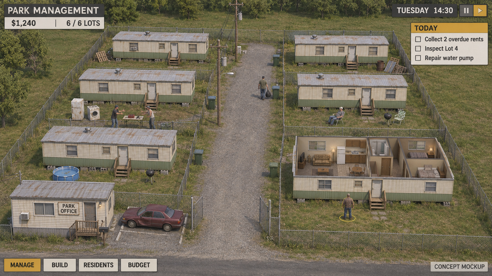

# Trailer-Park

A trailer park management project with an original setting. The latest discussion explores cooperative Cities: Skylines-style park planning, infrastructure and finances; the earlier Sims-style personal-life simulation and playable supervisor role are unsettled. Multiplayer is required, with a working target of 2–4 people in one game.

**Current state: one furnished Blender trailer asset and design concepts. The user rejected the existing character models and requested their removal; the trailer is the only approved asset so far. No Godot project or playable game exists yet.**

Start with [the project handoff](docs/PROJECT_HANDOFF.md) when continuing in a new chat. It distinguishes user requests, proposed features and implemented assets.

## Art direction

An angled overhead camera with zoom and rotation is the proposed presentation. The furnished trailer establishes the current asset style: realistic proportions, faded siding and worn possessions. Park-wide visual details and any future resident models still need approval.

The image is an AI-generated concept mockup, not a screenshot. Detailed vegetation, resident behavior and the displayed UI are not implemented.

## Existing assets

- [Furnished single-wide trailer](assets/trailers/weathered_singlewide/README.md): editable Blender model, full GLB, interior/exterior previews and rebuild scripts.
- [Concept art](docs/concept-art/README.md): mood, interior reference and management/life/build-mode mockups.
- [Show research notes](docs/research/README.md): preliminary recalled knowledge, explicitly unverified; not a completed show research corpus.

## Target platforms, engine and first milestone

The game will target **iOS and Android using Godot**. Godot 4 was previously recommended; the exact version, renderer and minimum supported devices remain undecided and require testing on mobile hardware. The user's MacBook Air does not set the game's performance requirements. No engine project or mobile export exists yet.

For the cooperative builder direction, a recommended first milestone is a two-player shared park using the existing trailer, three lots, independent overhead cameras with touch controls, synchronized placement, a shared budget and saving/reconnecting. Test up to four players early. Deeper infrastructure, economy and building tools would follow. Multiplayer permissions and shared state should be part of the initial architecture. Final gameplay scope remains to be settled.
